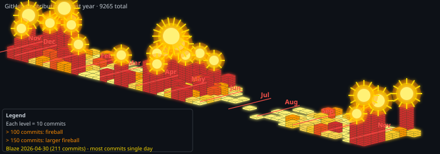

## About

I'm a DevOps/Site-Reliability Engineer who builds high-performance systems and developer tooling, with a focus on observability
[About Me](https://23skdu.github.io/)

<!-- contributions:start -->
<!-- heatmap:start -->
<!-- github-contributions:start -->

<!-- github-contributions:end -->
<!-- heatmap:end -->
<!-- contributions:end -->

<!-- weather:start -->
## 🎄✨ Seattle Weather & Sky · `47.6062 N, 122.3321 W` ✨🎄

| 🌌 Space/Time(spacetime) | 🌡️ Reading | ❄️ Details | 🌅 Night/Day Illumination |
| :--- | :---: | :--- | :---: |
| 🌟 **Today** · Nov 25 | **53 F** | 🌧️ Light drizzle | `7:29a` / `4:23p` |
| 🕯️ **Thursday** · Nov 26 | `54/47 F` | 🌧️ Light drizzle | `7:29a` / `4:23p` |
| 🦌 **Friday** · Nov 27 | `54/48 F` | 🌧️ Light rain shower | `7:31a` / `4:22p` |
| 🧣 **Saturday** · Nov 28 | `49/45 F` | 🌧️ Light rain | `7:32a` / `4:22p` |
| ☀️ **Sun** | ♐ Sagittarius `3°` | **6th House** · Placidus | `Nov 25 · 5:47 PM PST` |
| 🌙 **Moon** | ♊ Gemini `24°` | **12th House** · 🌕 97% | Full Moon |
| 🌑 **New Moon** | `Dec 8` | **6th House** ♐ · New cycle, 0% | `4:52p` PST |
| 🌓 **First Qtr** | `Dec 16` | **8th House** ♓ · Waxing, 50% | `9:43p` PST |
| 🌕 **Full Moon** | `Dec 23` | **12th House** ♋ · Peak light, 100% | `5:28p` PST |
| 🌗 **Last Qtr** | `Nov 30` | **1st House** ♍ · Release, 50% | `10:09p` PST |
<!-- weather:end -->

## License

This project is released into the public domain under the
[Unlicense](https://unlicense.org). See [LICENSE](LICENSE) for details.
